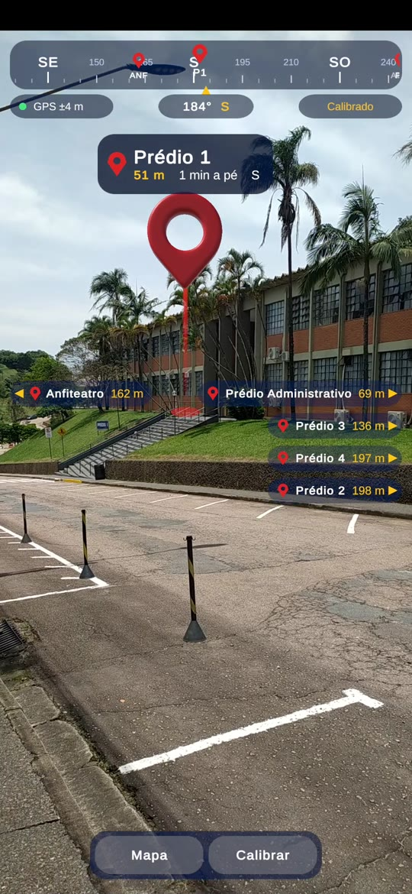
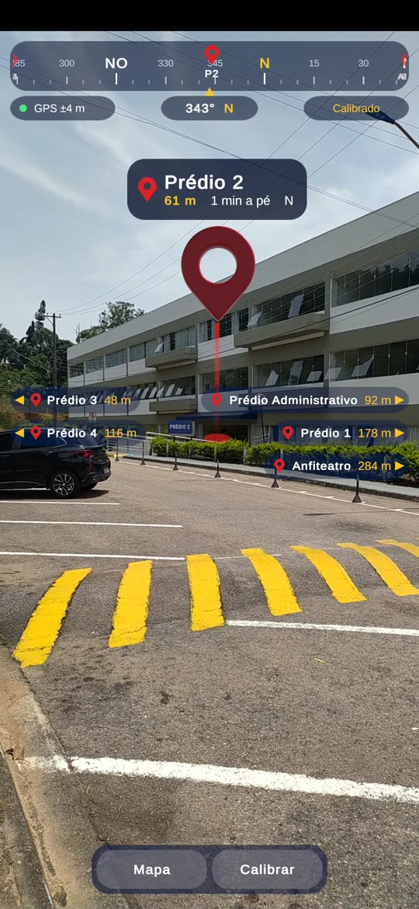
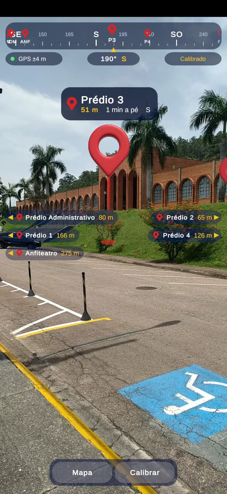
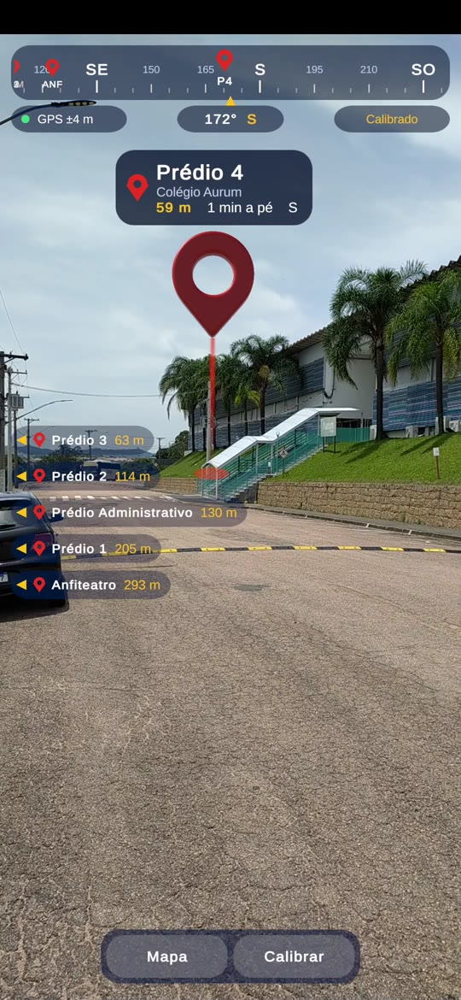
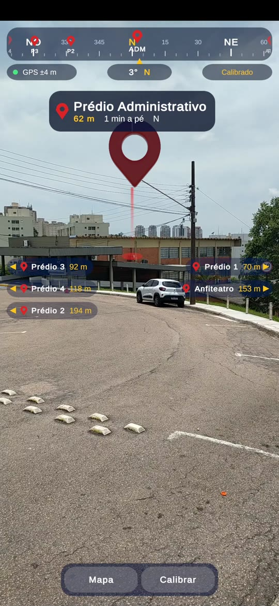
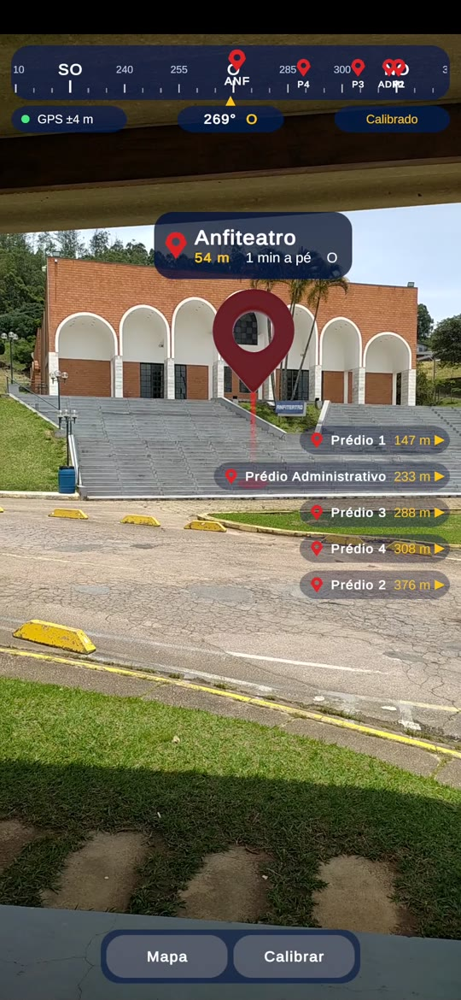

# Campus RA UniAnchieta

Aplicativo Android de **Realidade Aumentada markerless por geolocalização** que localiza os prédios do campus do Centro Universitário Padre Anchieta (Jundiaí/SP). Com o celular apontado para o campus, cada prédio ganha um **marcador 3D (pin)** com o **nome logo acima** e a distância até você.

> Atividade 03 – Realidade Aumentada Markerless · Mundos Virtuais e Realidade Aumentada · Prof. Clayton Valdo · Grupo Anchieta

**[Baixar o APK (v1.0)](https://github.com/bielCSTN/campus-ra-anchieta/releases/latest/download/CampusRA_Anchieta.apk)** · Android 10 ou superior com suporte a ARCore

<p align="center">
  
  
  
  
  
  
</p>

## Integrantes

| Nome | RA |
|---|---|
| Gabriel C. Santana | 2303778 |
| Pablo H. Gonçalves | 2304299 |
| Robertt Trujilho | 2303283 |
| Victor Nascimento | 2303242 |

## Pontos mapeados

| Ponto | Latitude | Longitude | Distância no teste |
|---|---|---|---|
| Prédio 1 | -23.214352 | -46.891550 | 51 m |
| Prédio 2 | -23.212888 | -46.893126 | 61 m |
| Prédio 3 | -23.213839 | -46.892866 | 51 m |
| Prédio 4 (Colégio Aurum) | -23.214382 | -46.893382 | 59 m |
| Prédio Administrativo | -23.213872 | -46.892210 | 62 m |
| Anfiteatro | -23.215287 | -46.891070 | 54 m |

Coordenadas coletadas no Google Maps. Todos os pontos foram localizados a **mais de 50 m** de distância, como pede o enunciado, e ficam a mais de 50 m uns dos outros. Biblioteca e cantinas também estão cadastradas, mas desativadas (dá pra ligar no Inspector).

## Funcionalidades

- **Marcador 3D** (`map_pin.fbx` fornecido na atividade) sobre cada prédio, sempre virado para a câmera.
- **Nome e distância** logo acima do pin; o prédio no centro da tela ganha uma ficha com distância, tempo a pé e direção.
- **Feixe** ligando o pin à base real do prédio, para deixar claro a qual construção ele pertence.
- **Bússola em fita** no topo, com os prédios marcados por sigla (P1, P2, ADM, ANF…).
- **Indicadores laterais** apontando para prédios fora do campo de visão.
- **Mapa do campus** na abertura, com a posição do usuário.
- **Calibração**: aponte a mira para um prédio conhecido e toque em *Alinhar*; ajuste fino de ±2°.

## Como funciona

Não há marcador impresso nem reconhecimento de imagem. O app combina três fontes:

1. **GPS** (`LocationProvider`) – posição do usuário, convertida de lat/lon para metros num plano local **ENU** (Leste/Norte) centrado no campus.
2. **Bússola** (`HeadingProvider`) – azimute da **câmera traseira**, calculado com acelerômetro + magnetômetro (o *heading* padrão do Android fica instável com o celular em pé) e corrigido pela declinação magnética local (≈ −21,5°).
3. **ARCore** (AR Foundation) – rastreamento de 6 graus de liberdade da câmera, preciso no curto prazo.

O `GeoARManager` junta tudo:

- **Alinhamento:** compara o *yaw* da câmera no mundo do ARCore com o azimute da bússola e descobre para onde fica o Norte no mundo AR (`yawNorte`). A calibração manual substitui a bússola quando ela sofre interferência.
- **Posição:** filtro complementar – o deslocamento curto vem do ARCore (sem ruído) e o GPS corrige devagar a deriva, com peso proporcional à precisão informada.
- **Renderização:** cada prédio vira um pin na direção certa. Pins distantes são desenhados a no máximo 60 m e escalados para manter um tamanho visível; a altura é limitada para não sair da tela.

## Tecnologias

- Unity **6000.6.0f1** (template AR Mobile, URP 17.6)
- AR Foundation **6.6.2** + Google ARCore XR Plugin **6.6.2**
- Input System 1.20 (+ Input Manager antigo para GPS/bússola – *Active Input Handling: Both*)
- TextMesh Pro (interface)
- Android 10+ (API 29), ARM64, IL2CPP – testado num Xiaomi Redmi Note 8

## Estrutura

```
Assets/MVRA/
├── Scripts/
│   ├── GeoPoint.cs          coordenadas dos prédios (editáveis no Inspector)
│   ├── GeoMath.cs           lat/lon → metros (ENU), azimute, formatação
│   ├── LocationProvider.cs  GPS: permissão, início, reconexão, simulação no Editor
│   ├── HeadingProvider.cs   bússola da câmera traseira + declinação
│   ├── GeoARManager.cs      alinhamento Norte↔ARCore, fusão GPS+AR, posição dos pins
│   ├── GeoPinView.cs        pin 3D: normalização do modelo, cor, foco, animação
│   ├── ARHud.cs             interface: bússola em fita, cartões, feixes, mapa, calibração
│   ├── UiKit.cs             paleta, sprites gerados por código e fábricas de UI
│   └── EditorSimulator.cs   controles para testar no Editor
├── Editor/MVRASetup.cs      menu "MVRA": configuração, cena e build
├── Models/map_pin.fbx       marcador da atividade
└── Scenes/CampusRA.unity    cena principal
docs/                        guia rápido e imagens
```

## Como rodar

1. Abra a pasta no **Unity Hub** com o Unity 6000.6.0f1 (os pacotes são baixados automaticamente).
2. Menu **MVRA > 1. Configurar projeto** (Android, ARCore, Input *Both*) e reinicie o Unity.
3. Abra `Assets/MVRA/Scenes/CampusRA.unity` (ou use **MVRA > 2. Criar cena CampusRA**).
4. **Testar no Editor:** Play → botão direito + arrastar para olhar, WASD para andar (GPS simulado no campus).
5. **Celular:** ative a depuração USB e use **MVRA > 4. Gerar APK e instalar no celular**.

O APK pronto fica em *Releases*. Mais detalhes em [docs/GUIA_RAPIDO.md](docs/GUIA_RAPIDO.md).

## Dicas de uso no campus

- Ative o GPS em alta precisão e espere alguns segundos ao ar livre.
- Segure o celular em pé. Se os pins ficarem desalinhados: **Calibrar** → escolha um prédio visível → mira no centro dele → **Alinhar**.
- Estruturas metálicas e carros perto atrapalham a bússola; a calibração resolve.
